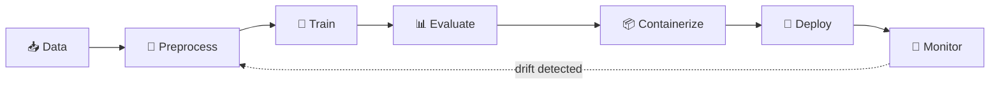

<div align="center">


<a href="https://github.com/realhassandev">
  
</a>

<br/>

<a href="mailto:hassanali93r@gmail.com"></a>
<a href="https://linkedin.com/in/hasanali09"></a>
<a href="https://hassan-ali-portfolio-nine.vercel.app"></a>

</div>

<br/>

```bash
hassan@realhassandev:~$ whoami
Hassan Ali — ML Engineer (Deep Learning | Computer Vision | NLP)

hassan@realhassandev:~$ cat now.txt
building   → End-to-end ML deployment pipelines (FastAPI + AWS SageMaker)
learning   → MLOps, Kubernetes, advanced deep learning (PyTorch + TensorFlow)
open to    → AI/ML projects, model deployment, open-source MLOps tooling

hassan@realhassandev:~$ _
```

## 🔁 How I work: the pipeline

Every project I take on follows the same loop. Models that never leave a notebook don't count.



## 🧰 Toolchain, by pipeline stage

<table>
  <tr>
    <td width="170"><b>🧠 Build models</b></td>
    <td></td>
  </tr>
  <tr>
    <td><b>🔌 Serve &amp; build apps</b></td>
    <td></td>
  </tr>
  <tr>
    <td><b>📦 Ship</b></td>
    <td></td>
  </tr>
  <tr>
    <td><b>☁️ Cloud</b></td>
    <td></td>
  </tr>
  <tr>
    <td><b>🗄️ Data &amp; streams</b></td>
    <td></td>
  </tr>
  <tr>
    <td><b>📡 Observe</b></td>
    <td></td>
  </tr>
  <tr>
    <td><b>🖥️ Environment</b></td>
    <td></td>
  </tr>
</table>

## 🪪 Model card

| | |
|---|---|
| **Name** | Hassan Ali |
| **Task** | Turning trained models into reliable production systems |
| **Architectures** | CNNs, Transformers, classical ML, plus the infra around them |
| **Trained on** | Deep learning, computer vision, NLP, data preprocessing |
| **Serving stack** | FastAPI · Docker · AWS SageMaker · Kubernetes (in progress) |
| **Intended use** | AI/ML products, model deployment, MLOps tooling, open source |
| **Ask me about** | MLOps, FastAPI, SageMaker, Docker, deep neural networks, NLP |
| **Known limitations** | Will talk about deployment for far too long |

## 📈 Telemetry

<div align="center">


<br/>


</div>

## 🤝 Let's collaborate

If you're working on AI/ML projects, model deployment, or open-source MLOps tooling, I'd like to hear about it.

📫 **hassanali93r@gmail.com**

<div align="center">


</div>
